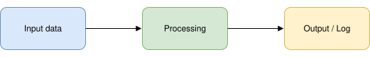
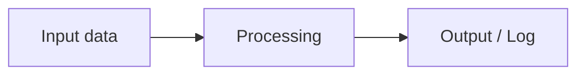

# Concept

## Goal

What problem does the project solve? What is explicitly out of scope?

## Architecture

## Components

| Component | Responsibility |
| --------- | -------------- |
| Input     | ... |
| Processing| ... |
| Output    | ... |

## Data flow

## Open questions

- ...
